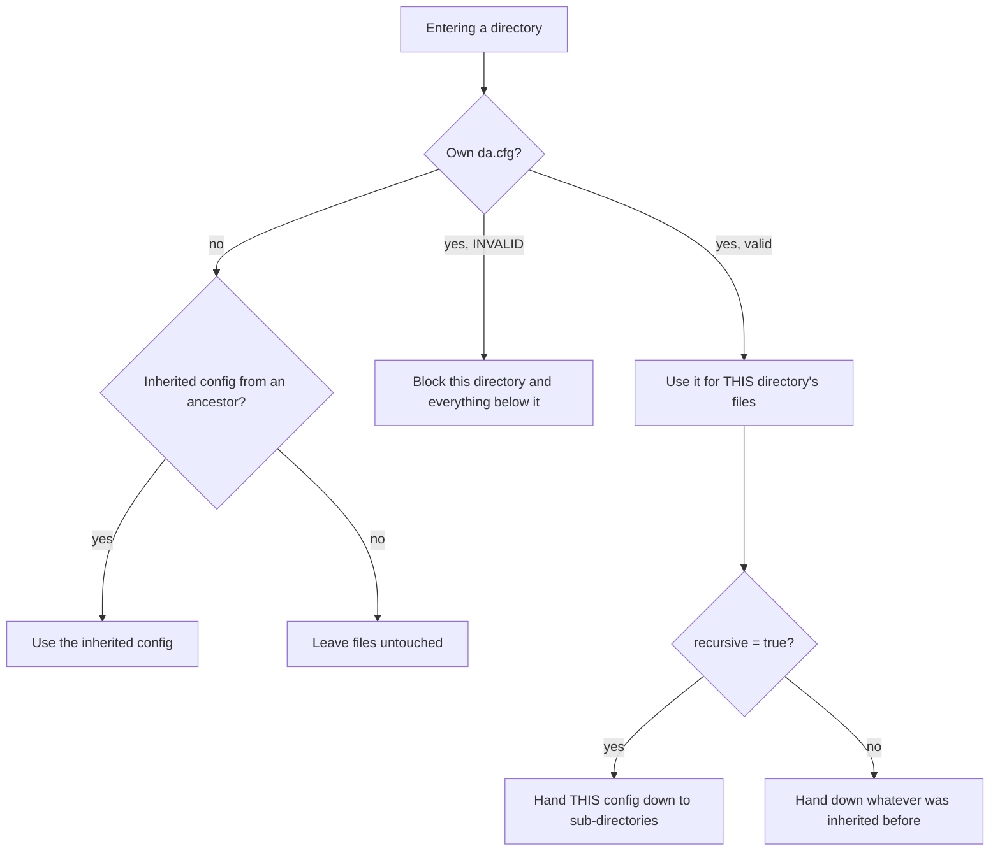

# Config-Driven File Retention Archiver


**One script that safely cleans up (or archives) files across thousands of directories, driven by a tiny config file that lives next to the data.**

Instead of maintaining many hard-coded cleanup jobs (one per path, each with its own retention and file pattern), you run a single
job over the whole tree. Each directory can carry a `da.cfg` with four settings. Sub-directories inherit from their parents,
can override them, or can opt out. Teams own their retention rules; the platform owns the script.

- Pure Python 3.9+ standard library: no dependencies, one file (`retention_archiver.py`)
- **Safe by default:** dry run unless `--execute`, per-file re-verification, symlinks never followed, circuit breaker, audit report
- Built for large NFS-style trees: one `scandir` per directory, lazy `stat`, parallel deletes
- 45 automated tests, including inheritance rules and failure cases

## The four settings

```ini
# da.cfg  (full-line comments only; inline comments are not supported)
[retention]
# REQUIRED regex on the file name: only matching names are ever touched
sourceFileIncludePattern=/^.*\.csv$/
# optional regex (may be empty): matching names are always protected
sourceFileExcludePattern=/^temp.*\.gz$/
# REQUIRED integer >= 1: eligible when strictly older than this many days
retentionDays=60
# TRUE or FALSE, case-insensitive (default FALSE): sub-directories inherit this config
recursive=TRUE
```

Regex values may be wrapped in slashes (`/regex/`); the slashes are optional. Patterns are matched against the **file name only**.
Keys are case-insensitive, unknown keys are errors.

## How inheritance works



1. A directory's own config always applies to its own files.
2. `recursive = true` makes the config the default for every sub-directory that has none.
3. `recursive = false` keeps the config local; deeper directories keep using the nearest recursive ancestor, if there is one.
4. No applicable config means files are left alone. An invalid config blocks its whole subtree (fail safe, never guess).

Ten worked examples with directory trees are in [`docs/USE_CASES.md`](docs/USE_CASES.md).

## Try it in 60 seconds (nothing real is touched)

```bash
python examples/make_sample_tree.py                     # builds ./sandbox/warehouse with back-dated files
python retention_archiver.py sandbox/warehouse --report plan.csv
```

Real output from that demo tree:

```
ERROR INVALID config in '.../warehouse/broken' (sourceFileIncludePattern: invalid regex '(' ...); subtree blocked
INFO scan complete: 9 eligible files (90 B)

=== retention_archiver summary (DRY RUN) ===
  config_errors            1
  configs_loaded           4
  dirs_scanned             14
  files_blocked            1
  files_eligible           9
  files_excluded           1
  files_no_rule            1
  files_not_matched        3
  files_seen               21
  files_too_recent         1
```

Ask *why* a file was or wasn't picked:

```bash
python retention_archiver.py sandbox/warehouse --explain sandbox/warehouse/app/audit/old/system.log
```
```
[app] local config: rule from '.../app' (include='\\.log$', retentionDays=60, recursive=true)
[app/audit] local config: rule from '.../app/audit' (include='\\.txt$', retentionDays=15, recursive=false)
[app/audit/old] no local config
      -> applies here: rule from '.../app' (include='\\.log$', retentionDays=60, recursive=true)
VERDICT for system.log: eligible (age 80.0 days)
```

## Command line

| Option | Purpose |
|---|---|
| `ROOT` | Directory tree to process |
| `--execute` | Actually delete/move. Without it, nothing changes (dry run) |
| `--action delete\|move` | Delete (default) or move to an archive area |
| `--archive-dir DIR` | Destination for `move` (must be outside ROOT; relative structure is preserved, nothing is overwritten) |
| `--max-delete N` | Refuse to execute if more than N files are eligible (circuit breaker) |
| `--workers N` | Parallel deletes/moves (helps on network filesystems) |
| `--report FILE.csv` | Audit trail: one row per eligible file with status |
| `--summary-json FILE` | Machine-readable run summary |
| `--explain PATH` | Show the config chain and verdict for a directory or file, then exit |
| `--config-name NAME` | Use a different config file name (default `da.cfg`) |
| `--min-depth N` | Refuse roots shallower than N path levels (default 2) |
| `--strict` | Exit 1 if any config was invalid or any directory unreadable |
| `--now ISO` | Fix "now" for reproducible runs and tests |

Exit codes: `0` success, `1` finished with errors, `2` refused by a safety guard or bad usage.

## Safety features

| Risk | Protection |
|---|---|
| Wrong path, huge blast radius | Dry run by default; protected roots (`/`, `/etc`, `/usr`, ...) and shallow roots refused |
| Typo in a config | Unknown keys, duplicate keys, bad regex, `retentionDays < 1` all make the config invalid; the subtree is skipped, not guessed |
| Over-broad cleanup | `sourceFileIncludePattern` is mandatory: you must say what may be removed |
| File changed after the scan | Size and mtime are re-checked right before acting; changed files are skipped |
| Symlink swapped in after the scan | Re-checked with `lstat`; non-regular files are skipped |
| Symlinks in the tree | Never followed, never deleted |
| Runaway deletion | `--max-delete` stops the run before anything is touched |
| Two runs at once | Per-root lock file |
| Losing data you wanted | `--action move` keeps files in an archive area; no overwrites (`.dupN` suffix) |
| "What did it do?" | CSV report and JSON summary |
| Config deleted by its own rule | Config files are never candidates |

## Performance notes

- One `scandir` per directory, iterative traversal (no recursion limit, handles very deep trees).
- `stat()` is only called for files whose name matches the include pattern and not the exclude pattern. On NFS each avoided `stat` is a saved network round trip.
- Regexes are compiled once and cached.
- Deletes/moves run in a thread pool (`--workers`).
- Memory is proportional to the number of *eligible* files (the plan is held so `--max-delete` and the report work).
- Local reference point (ext4, single core, 2,000 directories / 50,000 files): dry run 0.24 s, delete 0.40 s. Reproduce with `examples/benchmark.py`. Network filesystems are slower because of round trips, so measure on your own storage.

## Operating it

See [`docs/OPERATIONS.md`](docs/OPERATIONS.md) for the rollout plan (dry run, review, move-to-archive, delete), cron and systemd examples,
monitoring and rollback. Design rationale and trade-offs are in [`docs/DESIGN.md`](docs/DESIGN.md).

## Project layout

```
retention_archiver.py     the whole tool (single script)
docs/USE_CASES.md         10 worked scenarios with directory trees and results
docs/DESIGN.md            problem, algorithm, decisions, limitations
docs/OPERATIONS.md        runbook: rollout, scheduling, monitoring, rollback
examples/                 demo tree generator, benchmark, sample configs
tests/                    45 tests (config, inheritance, actions, safety)
```

## Testing

```bash
pip install -r requirements-dev.txt
pytest -q
```

## Limitations

- POSIX filesystems (uses `fcntl` locking and `scandir`); Windows is not a target.
- Age is based on modification time (`mtime`). Files whose mtime is preserved from a source system may look older than they are.
- The plan is held in memory; for hundreds of millions of eligible files, run on sub-trees.
- Empty directories are not removed (a possible extension).

## License

MIT. All example data is synthetic.
